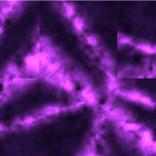
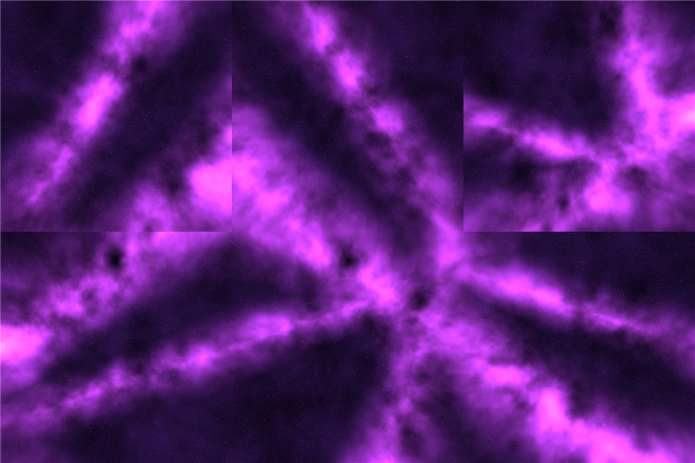

# Majestic Sky 2.0

made by ways, discord: waystobe

a different shading of Majestic Pink Sky under another name. it uses optifine style sky files (`assets/minecraft/optifine/sky`), so it needs OptiFine or a mod that reads those.

pack format 15 (see pack.mcmeta for the supported formats)

